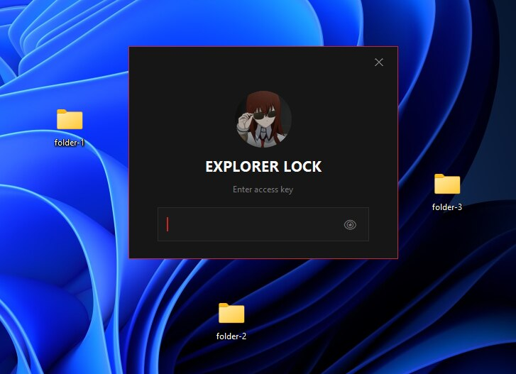

<a href="README.md">
  
</a>
<a href="README-TR.md">
  
</a>

  <br />
  <br />

<div align="center">
  
  <br />
  <br />

  <p>
     Windows Dosya Gezgini'ni şifreyle kilitleyen hafif bir araç.
  </p>


  <p>
    <a href="#warning">Uyarı</a> •
    <a href="#about">Hakkında</a> •
    <a href="#features">Özellikler</a> •
    <a href="#tech">Teknolojiler</a> •
    <a href="#setup">Kurulum</a> •
    <a href="#license">Lisans</a>
  </p>

  <br />
  <br />
</div>

## <a id="warning"></a> ⚠️ Uyarı

Bu proje daha önce **Aether Guard** adıyla yayınlanıyordu. Ne işe yaradığını daha iyi anlatması için adı **Explorer Lock** olarak değiştirildi. Bu değişiklikle birlikte Aether logosu yeni logoyla değiştirildi, şifre penceresinin kenarlığı ve giriş imleci yeşilden kırmızıya çevrildi, arka planda başlatma dosyasının adı da `run-explorer-lock.vbs` oldu.



## <a id="about"></a> 📋 Hakkında

**Explorer Lock**, Windows Dosya Gezgini'ni şifreyle koruyan hafif bir araçtır. Arka planda çalışır ve Gezgin pencerelerini izler. Bir klasör açıldığında pencere anında gizlenip kapatılır ve ekranın ortasında bir şifre penceresi belirir.

Doğru şifreyi girdikten sonra Dosya Gezgini'ni özgürce kullanabilirsiniz. Son Gezgin penceresini kapattıktan 5 dakika sonra koruma yeniden devreye girer. Art arda girilen yanlış şifreler, şifre penceresini giderek uzayan sürelerle kilitler.

## <a id="features"></a> ✨ Özellikler

- **Dosya Gezgini koruması**: Doğru şifre girilene kadar her Gezgin penceresi gizlenip kapatılır.
- **Şifre penceresi**: Şifreyi gösterin veya gizleyin, Enter ile onaylayın, Esc ile kapatın. Pencere sürüklenebilir ve yanlış şifrede sallanır.
- **Kaba kuvvet koruması**: 5 yanlış denemeden sonra şifre penceresi 60 saniye kilitlenir. Her yeni kilitlemede süre iki katına çıkar, en fazla 1 saate ulaşır ve kalan süre anlık olarak gösterilir.
- **Oturum süresi**: Çalışırken yetkili kalın. Son Gezgin penceresi kapatıldıktan 5 dakika sonra koruma yeniden devreye girer.
- **Tek kopya**: Uygulama zaten çalışıyorsa ikinci bir kopyası başlatılmaz.
- **Arka planda çalışma**: Uygulamayı VBS dosyasıyla başlatarak konsol penceresi olmadan çalıştırın.

## <a id="tech"></a> 🛠️ Teknolojiler

`Python` · `Tkinter` · `pywin32` · `Pillow`

## <a id="setup"></a> 🚀 Kurulum

### Gereksinimler

- **Windows 10 veya 11**
- **Python**

### Adım Adım Kurulum

1. **Depoyu klonlayın**

   ```bash
   git clone https://github.com/xkintaro/explorer-lock.git
   cd explorer-lock
   ```

2. **Bağımlılıkları yükleyin**

   ```bash
   pip install -r requirements.txt
   ```

3. **Uygulamayı başlatın**

   ```bash
   python app.py
   ```

### Kullanım

- Uygulamayı konsol penceresiyle başlatmak için `run.bat`, arka planda başlatmak için `run-explorer-lock.vbs` dosyasını çalıştırın.
- Varsayılan şifre `1234`'tür.
- Uygulamayı durdurmak için konsolda `Ctrl+C` tuşlarına basın. Arka planda çalışıyorsa `python.exe` işlemini Görev Yöneticisi'nden sonlandırın.

### Yapılandırma

Ayarları `app.py` dosyasının başındaki `Config` sınıfından değiştirebilirsiniz:

```python
class Config:
    DEFAULT_PASSWORD = "1234"         # Your master access key
    MAX_ATTEMPTS = 5                  # Attempts allowed before lockout
    LOCKOUT_TIME = 60                 # Initial lockout duration in seconds
    GRACE_PERIOD = 300                # Authorized session duration in seconds
```

## <a id="license"></a> 📄 Lisans

Bu proje MIT Lisansı altında lisanslanmıştır. Detaylar için [LICENSE](LICENSE) dosyasına bakabilirsiniz.

#

<p align="center">
  <sub>❤️ Developed by "Mustafa TAŞAL" (kintaro)</sub>
</p>
