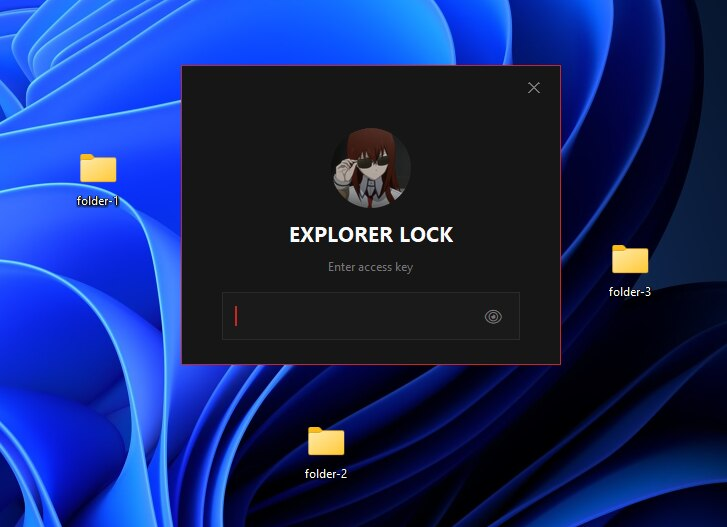

<a href="README.md">
  
</a>
<a href="README-TR.md">
  
</a>

  <br />
  <br />

<div align="center">
  
  <br />
  <br />

  <p>
     A lightweight tool that locks Windows File Explorer behind a password.
  </p>


  <p>
    <a href="#warning">Warning</a> •
    <a href="#about">About</a> •
    <a href="#features">Features</a> •
    <a href="#tech">Tech</a> •
    <a href="#setup">Setup</a> •
    <a href="#license">License</a>
  </p>

  <br />
  <br />
</div>



## <a id="warning"></a> ⚠️ Warning

This project was previously published as **Aether Guard**. It has been renamed to **Explorer Lock** to better describe what it does. As part of this change, the Aether logo was replaced with a new logo, the border and input cursor of the password window were changed from green to red, and the background launcher was renamed to `run-explorer-lock.vbs`.

## <a id="about"></a> 📋 About

**Explorer Lock** is a lightweight tool that protects Windows File Explorer with a password. It runs in the background and watches for Explorer windows. When a folder is opened, the window is hidden and closed immediately, and a password prompt appears in the middle of the screen.

After you enter the correct password, you can use File Explorer freely. Protection turns back on 5 minutes after you close your last Explorer window. Repeated wrong passwords lock the prompt for a growing amount of time.

## <a id="features"></a> ✨ Features

- **File Explorer protection**: Every Explorer window is hidden and closed until the correct password is entered.
- **Password prompt**: Show or hide the password, confirm with Enter and close with Esc. The prompt can be dragged and shakes on a wrong password.
- **Brute force protection**: After 5 wrong attempts the prompt is locked for 60 seconds. Each new lockout doubles the duration, up to 1 hour, with a live countdown.
- **Grace period**: Stay authorized while you work. Protection turns back on 5 minutes after the last Explorer window is closed.
- **Single instance**: A second copy of the app will not start while one is already running.
- **Background mode**: Start the app with the VBS launcher to run it without a console window.

## <a id="tech"></a> 🛠️ Tech

`Python` · `Tkinter` · `pywin32` · `Pillow`

## <a id="setup"></a> 🚀 Setup

### Requirements

- **Windows 10 or 11**
- **Python**

### Step-by-Step Installation

1. **Clone the repository**

   ```bash
   git clone https://github.com/xkintaro/explorer-lock.git
   cd explorer-lock
   ```

2. **Install dependencies**

   ```bash
   pip install -r requirements.txt
   ```

3. **Start the app**

   ```bash
   python app.py
   ```

### Usage

- Run `run.bat` to start the app with a console window, or `run-explorer-lock.vbs` to start it in the background.
- The default password is `1234`.
- To stop the app, press `Ctrl+C` in the console. If it runs in the background, end the `python.exe` process from Task Manager.

### Configuration

You can change the settings in the `Config` class at the top of `app.py`:

```python
class Config:
    DEFAULT_PASSWORD = "1234"         # Your master access key
    MAX_ATTEMPTS = 5                  # Attempts allowed before lockout
    LOCKOUT_TIME = 60                 # Initial lockout duration in seconds
    GRACE_PERIOD = 300                # Authorized session duration in seconds
```

## <a id="license"></a> 📄 License

This project is licensed under the MIT License. See the [LICENSE](LICENSE) file for details.

#

<p align="center">
  <sub>❤️ Developed by "Mustafa TAŞAL" (kintaro)</sub>
</p>
